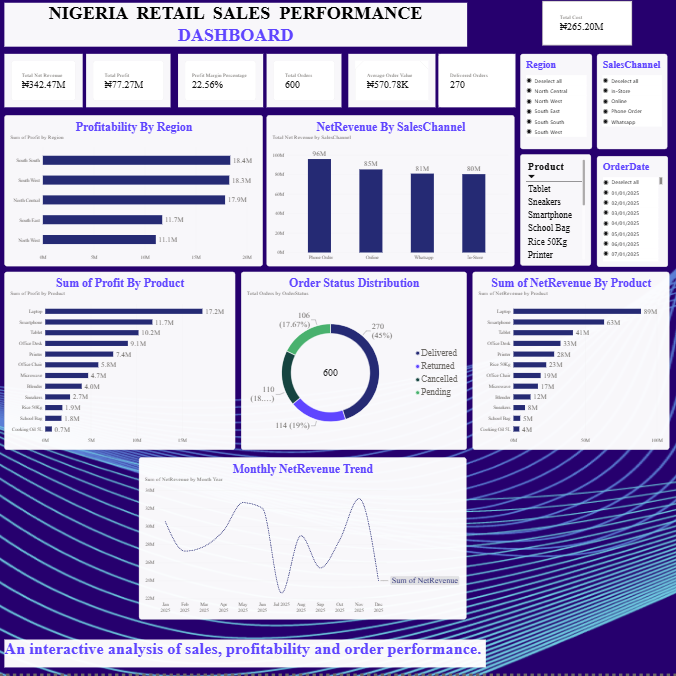

# Nigeria Retail Sales Analysis

## Project Overview

This project analyses Nigerian retail sales data using Excel, SQL, Python, and Power BI. The goal is to explore sales performance, identify trends, evaluate profitability, and generate insights that can support business decision-making.

## Business Objectives

* Analyse revenue, cost, and profit.
* Identify top-performing products and regions.
* Examine monthly sales trends.
* Compare sales channels and customer purchasing patterns.
* Review order statuses, including delivered, cancelled, returned, and pending orders.
* Present findings through data visualisations and dashboards.

## Tools and Technologies

* **Microsoft Excel:** Data cleaning, PivotTables, KPI summaries, and dashboard creation.
* **SQL (PostgreSQL):** Data querying, aggregation, and business analysis.
* **Python:** Data analysis, calculations, and visualisation.
* **Power BI:** Interactive dashboard development and visual reporting.

## Project Files

| File                                          | Description                                      |
| --------------------------------------------- | ------------------------------------------------ |
| `Nigeria_Retail_Sales_Excel_Analysis.xlsx`    | Excel analysis, PivotTables, KPIs, and dashboard |
| `Nigeria_Retail_Sales_SQL_Queries.sql`        | SQL queries for investigating retail sales       |
| `Nigeria_Retail_Sales_Python_Analysis.py`     | Python script for data analysis                  |
| `Nigeria_Retail_Sales_PowerBI_Dashboard.pbix` | Power BI dashboard report                        |

## Key Business Questions

1. Which products generate the most revenue and profit?
2. Which regions perform best in sales?
3. How does revenue change from month to month?
4. Which sales channels contribute most to revenue?
5. What is the distribution of order statuses?
6. How do revenue, cost, and profit compare?

## Expected Business Value

The analysis demonstrates how retail sales data can be transformed into useful information for monitoring performance, identifying opportunities, and supporting evidence-based business decisions.

## Project Status

The analysis was completed using Excel, SQL, Python, and Power BI. Dashboard screenshots and verified findings will be added to this repository as the portfolio presentation is finalised.

---

**Author:** Otso Anna Bala

Dashboard Preview
The dashboard below provides a visual overview of the Nigeria Retail Sales analysis.

## Key Findings

1. **Overall Profitability:** The business generated ₦342.47 million in net revenue, with a total cost of ₦265.20 million and a total profit of ₦77.27 million. The overall profit margin was 22.56%.

2. **Product Performance:** Laptops recorded the highest revenue of ₦89,914,375.00 and the highest profit of ₦17,216,875.00. Cooking Oil recorded the lowest profit at ₦726,028.75.

3. **Regional Performance:** South South recorded the highest regional profit at approximately ₦18.37 million, while North West recorded the lowest at approximately ₦11.07 million.

4. **Monthly Revenue Trend:** November recorded the highest net revenue at approximately ₦33.09 million, while July recorded the lowest at approximately ₦22.64 million.

5. **Sales Channel Performance:** Phone orders generated the highest net revenue at approximately ₦95.88 million, while in-store sales recorded the lowest at approximately ₦80.40 million.

6. **Order Status Distribution:** Out of 600 orders, 270 (45%) were delivered, 110 (18.33%) were cancelled, 114 (19%) were returned, and 106 (17.67%) were pending.

## Business Recommendations

* **Strengthen Product Performance:** Maintain adequate stock of high-performing products such as laptops and review the costs and pricing of products with lower profit contributions.

* **Improve Regional Performance:** Investigate the factors driving strong performance in the South South region and identify opportunities to improve sales in the North West.

* **Plan for Seasonal Demand:** Use monthly revenue trends to improve inventory planning and marketing strategies, particularly around high-performing months.

* **Strengthen Sales Channels:** Evaluate the factors contributing to strong phone-order performance and explore ways to improve in-store sales.

* **Reduce Cancellations and Returns:** Investigate the reasons behind cancelled and returned orders and introduce measures to improve customer satisfaction.

* **Improve Order Fulfilment:** Monitor pending orders and develop strategies to ensure timely delivery and a better customer experience.

