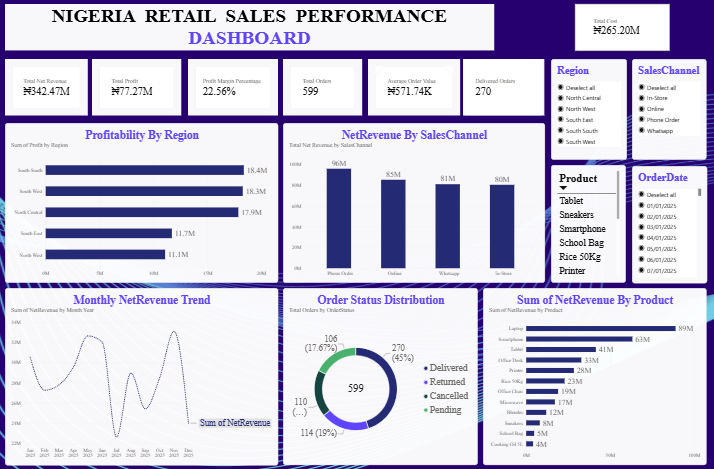

# Nigeria Retail Sales Analysis

## Project Overview

This project analyses Nigerian retail sales data using Excel, SQL, Python, and Power BI. The goal is to explore sales performance, identify trends, evaluate profitability, and generate insights that can support business decision-making.

## Business Objectives

* Analyse revenue, cost, and profit.
* Identify top-performing products and regions.
* Examine monthly sales trends.
* Compare sales channels and customer purchasing patterns.
* Review order statuses, including delivered, cancelled, returned, and pending orders.
* Present findings through data visualisations and dashboards.

## Tools and Technologies

* **Microsoft Excel:** Data cleaning, PivotTables, KPI summaries, and dashboard creation.
* **SQL (PostgreSQL):** Data querying, aggregation, and business analysis.
* **Python:** Data analysis, calculations, and visualisation.
* **Power BI:** Interactive dashboard development and visual reporting.

## Project Files

| File                                          | Description                                      |
| --------------------------------------------- | ------------------------------------------------ |
| `Nigeria_Retail_Sales_Excel_Analysis.xlsx`    | Excel analysis, PivotTables, KPIs, and dashboard |
| `Nigeria_Retail_Sales_SQL_Queries.sql`        | SQL queries for investigating retail sales       |
| `Nigeria_Retail_Sales_Python_Analysis.py`     | Python script for data analysis                  |
| `Nigeria_Retail_Sales_PowerBI_Dashboard.pbix` | Power BI dashboard report                        |

## Key Business Questions

1. Which products generate the most revenue and profit?
2. Which regions perform best in sales?
3. How does revenue change from month to month?
4. Which sales channels contribute most to revenue?
5. What is the distribution of order statuses?
6. How do revenue, cost, and profit compare?

## Expected Business Value

The analysis demonstrates how retail sales data can be transformed into useful information for monitoring performance, identifying opportunities, and supporting evidence-based business decisions.

## Project Status

The analysis was completed using Excel, SQL, Python, and Power BI. Dashboard screenshots and verified findings will be added to this repository as the portfolio presentation is finalised.

---

**Author:** Otso Anna Bala

Dashboard Preview
The dashboard below provides a visual overview of the Nigeria Retail Sales analysis.

